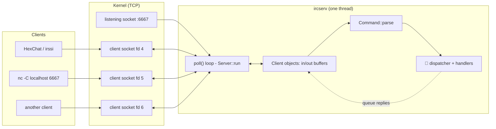
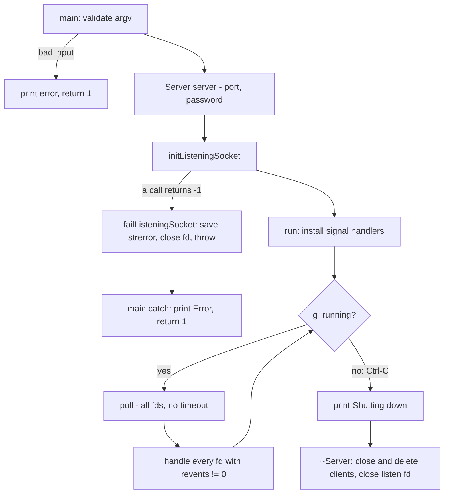
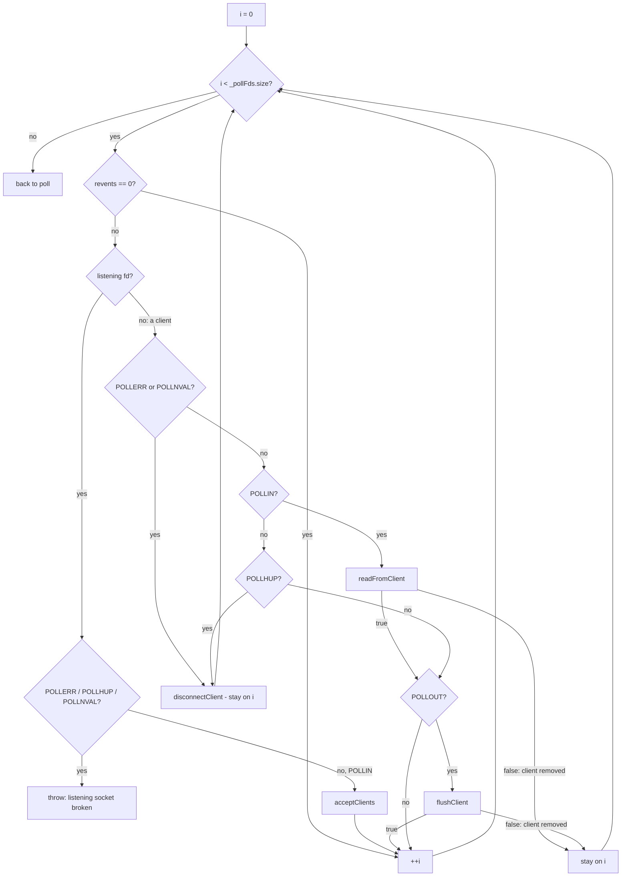
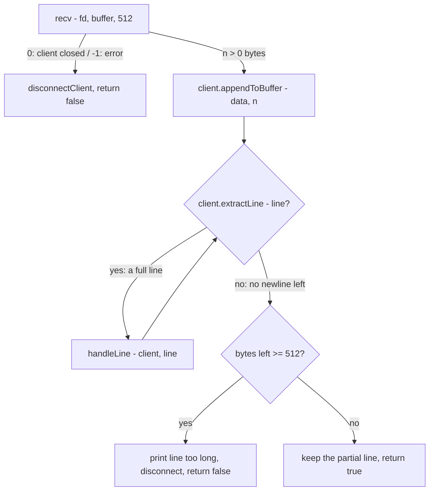
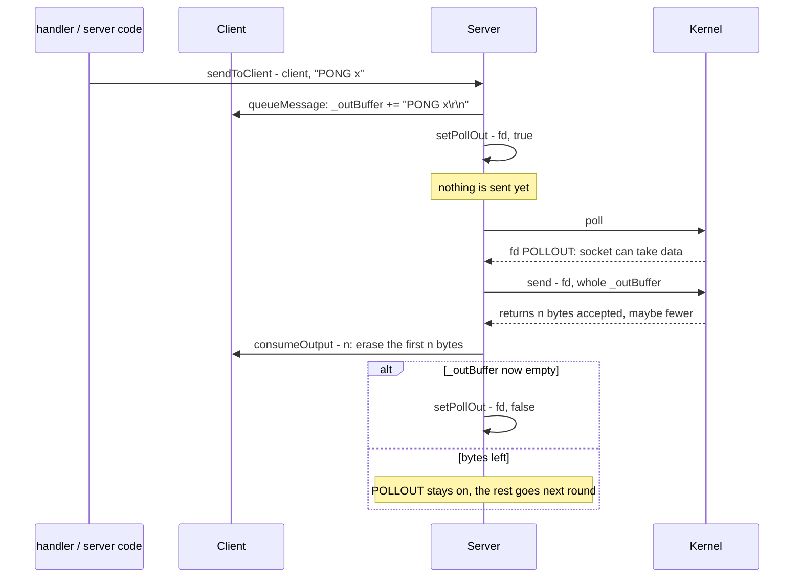
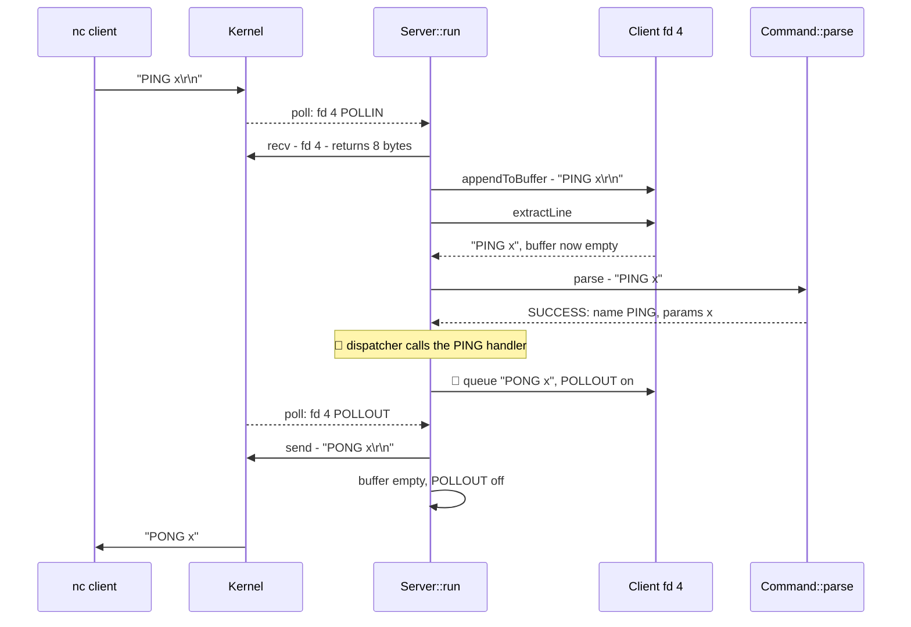
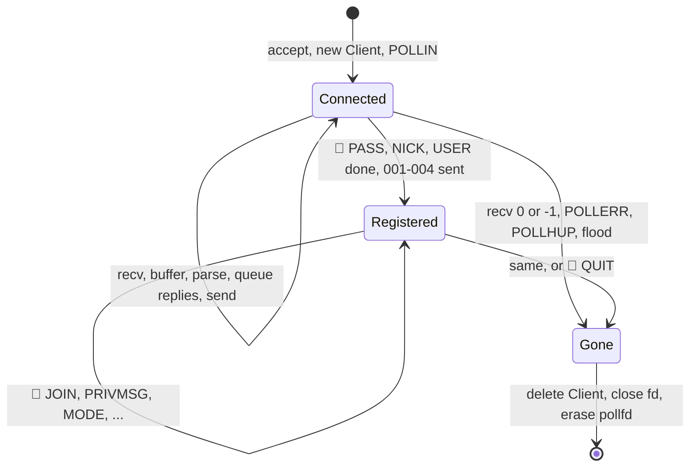
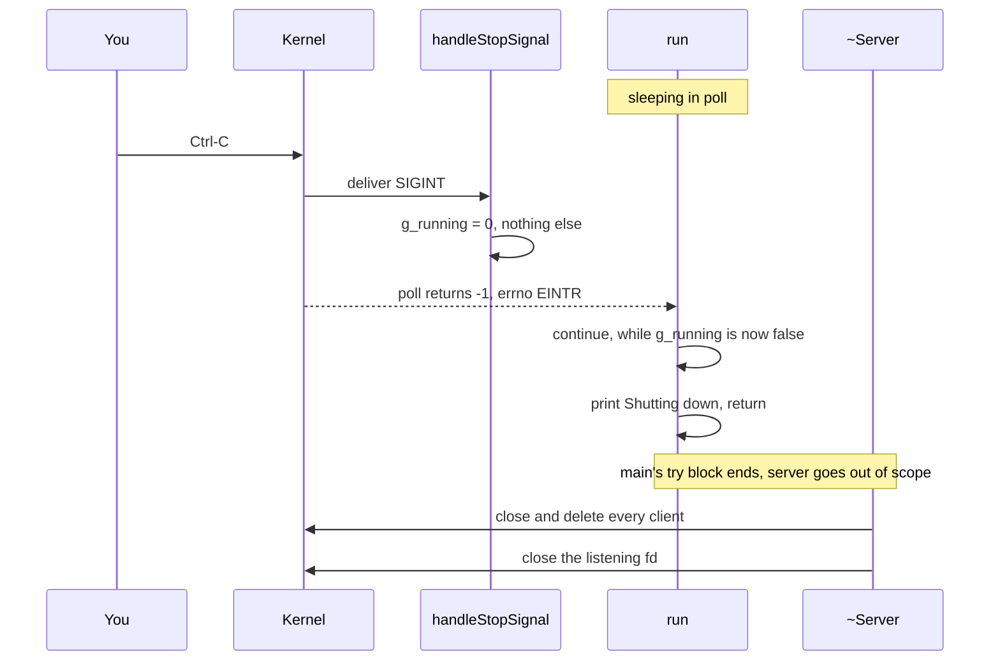
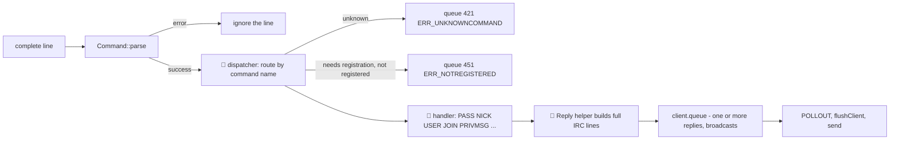
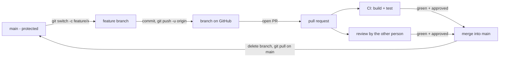

# ft_irc: Complete Project Workflow

A study guide to the whole server: what happens from `./ircserv 6667 pw` to
Ctrl-C, how a message travels from a client's keyboard to the server and
back, which class owns what, and how the team builds, tests and merges it.

> Diagrams are Mermaid. They render on GitHub, and in VS Code with the
> Markdown preview (`Ctrl+Shift+V`) or a Mermaid preview extension.
>
> **Status markers:** ✅ = in `main` today. 🚧 = planned or being built
> (mostly Sami's part). Everything without a marker is in the code now.

**Interactive study page** (same content, styled diagrams, and playgrounds
for the input and output buffers): https://claude.ai/artifact/8avPGiciZQNtPE3sZx4Wxj
(private: share it from the page's Share menu before sending the link to
anyone else)

---

## Contents

1. [The big picture](#1-the-big-picture)
2. [Who owns what](#2-who-owns-what)
3. [Startup: arguments and the listening socket](#3-startup-arguments-and-the-listening-socket)
4. [The poll() loop](#4-the-poll-loop)
5. [Accepting clients](#5-accepting-clients)
6. [Reading: input buffering](#6-reading-input-buffering)
7. [Parsing a line into a Command](#7-parsing-a-line-into-a-command)
8. [Writing: output buffering and POLLOUT](#8-writing-output-buffering-and-pollout)
9. [The journey of one message, end to end](#9-the-journey-of-one-message-end-to-end)
10. [Disconnecting a client](#10-disconnecting-a-client)
11. [Shutdown: Ctrl-C to a clean exit](#11-shutdown-ctrl-c-to-a-clean-exit)
12. [🚧 What comes next: registration, commands, channels](#12--what-comes-next-registration-commands-channels)
13. [Rules the code follows](#13-rules-the-code-follows)
14. [Code map](#14-code-map)
15. [Testing and CI](#15-testing-and-ci)
16. [Team workflow: branches, PRs, reviews](#16-team-workflow-branches-prs-reviews)
17. [Check yourself](#17-check-yourself)

---

## 1. The big picture

ft_irc is one process with one thread. It never waits on a single client:
it asks the kernel, with **one `poll()` call**, "which of my sockets are
ready?", handles exactly those, and asks again.



The program has five phases:

| Phase | What happens | Code |
|---|---|---|
| 1. Validate | Check `argv`: exactly a port and a password | `main()` |
| 2. Construct | Store port and password, `_listenFd = -1` | `Server::Server()` |
| 3. Listen | `socket` → `setsockopt` → `fcntl` → `bind` → `listen` | `initListeningSocket()` |
| 4. **Loop** | `poll()`, then accept / read / write / disconnect | `run()` |
| 5. Clean up | Close every fd, delete every `Client` | `Server::~Server()` |



---

## 2. Who owns what

| Thing | Owner | Created | Destroyed |
|---|---|---|---|
| Listening fd | `Server` (`_listenFd`) | `initListeningSocket()` | `~Server()` via `closeListeningSocket()` |
| Each client fd | `Server` | `accept()` in `acceptClients()` | `close()` in `disconnectClient()` or `~Server()` |
| Each `Client` object | `Server` (`_clients` map) | `new Client(fd)` in `acceptClients()` | `delete` in `disconnectClient()` or `~Server()` |
| Input / output bytes | each `Client` (`_inBuffer`, `_outBuffer`) | `recv()` / `queueMessage()` | `extractLine()` / `consumeOutput()` |
| 🚧 Channels | `Server` (planned) | first `JOIN` | when empty |

Key design points:

- **`Client` never closes its fd.** Only the `Server` does, so every fd is
  closed exactly once.
- **`Server` and `Client` cannot be copied.** Their copy constructor and
  `operator=` are declared `private` and never defined (the C++98 way to
  forbid copying). A copy would hold the same fd, so it would be closed twice.
- **`explicit Client(int fd)`** stops the compiler from silently turning an
  `int` into a temporary `Client` (for example when passing an fd to a
  function that expects a `Client`).

### The two containers the loop works on

They are kept in sync: a client is in **both or neither**.

**`std::vector<pollfd> _pollFds`**: what the kernel watches.

| index | fd | events (we set) | revents (kernel fills, example) |
|---|---|---|---|
| 0 | 3 (listening) | `POLLIN` | `POLLIN`: a connection is waiting |
| 1 | 4 | `POLLIN` | `0`: nothing happened |
| 2 | 5 | `POLLIN \| POLLOUT` | `POLLOUT`: can send the queued reply |
| 3 | 6 | `POLLIN` | `POLLIN`: data, or the client closed |

**`std::map<int, Client *> _clients`**: what the server knows about each
connection, by fd.

| key (fd) | value |
|---|---|
| 4 | `Client(4)`: `_inBuffer = "NICK al"`, `_outBuffer = ""` |
| 5 | `Client(5)`: `_inBuffer = ""`, `_outBuffer = "PONG x\r\n"` |
| 6 | `Client(6)` |

- fds 0, 1 and 2 are stdin, stdout and stderr, so the listening socket is
  usually 3 and clients start at 4.
- `POLLHUP`, `POLLERR` and `POLLNVAL` are always reported, even if you didn't
  ask for them in `events`.

---

## 3. Startup: arguments and the listening socket

### `main()`: argument validation

| Check | Rejects |
|---|---|
| `argc != 3` | missing or extra arguments |
| `argv[2][0] == '\0'` | empty password |
| `isDigit(argv[1])` | `abc`, `66a7`, `-1`, `""` |
| `strtol` + `errno == ERANGE` | `99999999999999999999` (overflow) |
| `1 <= port <= 65535` | `0`, `65536` |

Every rejection prints a message to `stderr` and returns 1. Then:

```cpp
Server server(port, password);
server.initListeningSocket();   // may throw
server.run();                   // may throw
```

wrapped in `try { ... } catch (const std::exception &e)`, which prints
`Error: ...` and returns 1. Because `server` lives inside the `try`, its
destructor always runs, even when an exception is thrown.

### `initListeningSocket()`: the five socket calls

| Call | Why |
|---|---|
| `socket(AF_INET, SOCK_STREAM, 0)` | Create an IPv4 TCP endpoint. Returns an fd. |
| `setsockopt(SO_REUSEADDR)` | Restart on the same port right away instead of waiting ~60 s (TIME_WAIT). Must come **before** `bind`. |
| `fcntl(fd, F_SETFL, O_NONBLOCK)` | Non-blocking, as the subject requires. The only allowed `fcntl` form. |
| `bind(INADDR_ANY, htons(port))` | Claim the port on every interface. `htons` puts the 2 bytes in network (big-endian) order; without it, 6667 becomes 2842. |
| `listen(SOMAXCONN)` | Become a passive socket: the kernel queues incoming connections (the *backlog*) until we `accept()` them. |

Then the listening fd is pushed as `_pollFds[0]` with `events = POLLIN`.

If any call returns -1, `failListeningSocket("bind")` (for example):

1. reads `strerror(errno)` **first**, because `close()` may overwrite `errno`,
2. closes the fd,
3. throws `std::runtime_error("bind: Address already in use")`.

---

## 4. The poll() loop

`run()` installs the signal handlers (section 11), then:

```cpp
while (g_running)
{
    poll(&_pollFds[0], _pollFds.size(), -1);   // sleep until something is ready
    // walk _pollFds by index and react to each revents
}
```

- `-1` as the timeout means "no timeout": the server uses no CPU while idle.
- If `poll()` returns -1 with `errno == EINTR`, a signal interrupted it:
  `continue`, and `while (g_running)` notices Ctrl-C. Reading `errno` here is
  fine, because `poll()` isn't socket I/O.
- Any other `poll()` error throws.

### One pass through the poll set



| Flag in `revents` | On the listening fd | On a client fd |
|---|---|---|
| `POLLIN` | Connections are waiting: `accept()` until -1 | Bytes arrived, or the client closed: one `recv()` |
| `POLLOUT` | never requested | The socket can take data: one `send()` from `_outBuffer` |
| `POLLHUP` | broken: throw and shut down | Connection gone. Checked **after** `POLLIN`, so final data is still read |
| `POLLERR` / `POLLNVAL` | broken: throw and shut down | Socket error or invalid fd: disconnect now |

A client can be readable **and** writable in the same pass. That's why there
is no `continue` after a successful read: `POLLOUT` is checked right after.

### The trap: why an index, and no `++i` after an erase

Say fd 5 (index 2) disconnects, and fd 6 behind it also has data waiting.
`erase()` shifts every later element one slot to the left:

```
before erase:   [0] fd 3   [1] fd 4   [2] fd 5   [3] fd 6
after erase:    [0] fd 3   [1] fd 4   [2] fd 6
```

- **Wrong (always `++i`):** fd 6 slides into slot 2, then `i` becomes 3.
  fd 6 is skipped this pass, and its data waits for the next `poll()`.
- **Right (stay on `i` after an erase):** slot 2 now holds fd 6, so it's
  handled in the same pass.

That's why `readFromClient()` and `flushClient()` return `false` when they
removed the client: the loop then doesn't `++i`.

The opposite case is `push_back()` in `acceptClients()`: it can
**reallocate** the vector, which invalidates any `pollfd &` or iterator you
were holding. An index survives both, so the loop never keeps a reference
across a call. New clients are added at the end with `revents == 0`, so the
current pass skips them.

---

## 5. Accepting clients

`acceptClients()` runs when the listening fd reports `POLLIN`:

```
loop:
    fd = accept(listenFd)             -1 → backlog is empty, return
    fcntl(fd, F_SETFL, O_NONBLOCK)    fails → close(fd), try the next one
    try:
        client = new Client(fd)
        _clients[fd] = client
        _pollFds.push_back({fd, POLLIN})
    catch (std::bad_alloc):           out of memory
        undo: erase from map, delete client, close(fd)
        return                        retry on the next POLLIN
    print "Client connected: fd N from 1.2.3.4"
```

- **Why loop until -1?** Several clients can connect between two `poll()`
  calls, so one `POLLIN` can mean many waiting connections. Because the fd is
  non-blocking, `accept()` returns -1 when the queue is empty instead of
  freezing. We stop on the **return value**, never by checking `errno`.
- **Why the try/catch?** `new`, the map insertion and `push_back` can all
  throw `std::bad_alloc`. Without the `catch`, the accepted fd would leak,
  and the map and the poll set could get out of sync.

---

## 6. Reading: input buffering

### Why a buffer is needed

TCP is a **byte stream**, not a message stream. One `recv()` can return:

| What the client sent | What one `recv()` may return |
|---|---|
| `NICK alice\r\n` | `NICK al` (half a message) |
| `NICK alice\r\nUSER a 0 * :A\r\n` | both messages glued together |
| `PRIVMSG #a :hello\r\n` | `PRIV`, then `MSG #a :hello\r\n` in the next `recv()` |

The subject tests exactly this: `nc -C` with `com`, Ctrl-D, `man`, Ctrl-D,
`d`, Enter must be rebuilt into one command.

### `readFromClient(i)`, step by step



1. **One `recv()`** of up to 512 bytes. Only once per `POLLIN`: if more data
   is waiting, `poll()` reports `POLLIN` again on the next round.
2. **Append** the bytes to the client's `_inBuffer` with
   `append(data, len)`. The length matters: `recv()` doesn't add a `'\0'`, and
   the data may even contain `'\0'` bytes.
3. **Extract every complete line.** `extractLine()` searches for `'\n'`:
   - none found → returns `false`, and the buffer stays untouched;
   - found → copies everything before it (dropping a `'\r'` just before the
     `'\n'`), erases the line **and** its `'\n'` from the buffer, returns `true`.

   It accepts both `\r\n` (RFC) and a bare `\n` (some clients, and `nc`
   without `-C`).
4. **Whatever is left is a partial line**, kept for the next `recv()`.

### The 512-byte limit

RFC 2812 §2.3 (not the subject) says a message is at most **512 bytes,
`\r\n` included**, so 510 characters of content. The server enforces it in
two places:

| Situation | What happens | Where |
|---|---|---|
| 512 or more bytes are buffered with no `'\n'` | the client is **disconnected** (protection against flooding the buffer) | `readFromClient()` |
| a complete line is over 510 characters | `parse()` returns `PARSE_LINE_TOO_LONG`, and the line is **ignored** | `Command::parse()` |

The second case happens when the start and the end of a long line arrive
together in the same chunk. That's the policy agreed with Sami: overlong,
malformed and over-parameterized lines are ignored, and a client is only
dropped when its buffer floods.

`MAX_LINE_LEN = 512` is defined in `Server.hpp`.

---

## 7. Parsing a line into a Command

`handleLine()` ignores empty lines (the RFC says to) and calls
`Command::parse(line, cmd)`. The line arrives **without** its `\r\n`.

### IRC message grammar

```
[":" prefix " "] command [" " param]* [" :" trailing]
```

Example: `:alice!a@host PRIVMSG #chat :hello there`

| Part | Value | Getter |
|---|---|---|
| prefix | `alice!a@host` | `getPrefix()`, `hasPrefix()` |
| command | `PRIVMSG` | `getName()` |
| params | `#chat`, `hello there` | `getParams()` |
| trailing? | yes: the last param started with `:` | `hasTrailingParam()` |

The trailing parameter is the only one that may contain spaces. Everything
after ` :` is one parameter.

### What `parse()` checks

| Rule | Result if broken |
|---|---|
| More than 510 characters | `PARSE_LINE_TOO_LONG` |
| Empty, or contains `\r`, `\n` or `\0` | `PARSE_MALFORMED` |
| `:` prefix with nothing after it, or no command after it | `PARSE_MALFORMED` |
| Prefix contains a space, a control character or DEL | `PARSE_MALFORMED` |
| Command isn't all letters or exactly 3 digits (`NICK`, `001`) | `PARSE_MALFORMED` |
| More than 15 parameters | `PARSE_TOO_MANY_PARAMS` |
| Otherwise | `PARSE_SUCCESS` |

- Command names are converted to **uppercase**, so `nick` becomes `NICK`.
- Several spaces between parameters count as one.
- `parse()` fills a temporary `Command` and only copies it into `out` on
  success, so `out` is never half-filled.

Today `handleLine()` only prints the result (`[fd 4] command: NICK (1
params)`, or a parse error). Sending replies and running the command is
Sami's part 🚧 (section 12).

---

## 8. Writing: output buffering and POLLOUT

### Why output needs a buffer too

`send()` may accept only **part** of what you give it: the kernel's send
buffer for that socket can be full, for example with a slow client or a big
burst of messages. The rest must wait. And you may only call `send()` after
`poll()` reported `POLLOUT`.

### The three steps



| Function | Job |
|---|---|
| `Client::queueMessage(msg)` | Appends `msg + "\r\n"`. Callers never add `\r\n` themselves, so no reply can forget it. |
| `Server::sendToClient(client, msg)` | Queues the message and turns `POLLOUT` on for that fd. |
| `Server::flushClient(i)` | Called only after `POLLOUT`: one `send()`, then `consumeOutput(sent)`. `-1` → disconnect. Empty buffer → `POLLOUT` off. |
| `Server::setPollOut(fd, on)` | Finds the fd's entry in `_pollFds` and adds or removes `POLLOUT` in `events`. |

**Why `POLLOUT` is only on while there's output:** a socket is writable
almost all the time. If `POLLOUT` were always on, `poll()` would return
immediately on every round with nothing to send: a busy loop at 100% CPU.

**Why only the sent bytes are erased:** if `send()` took 3 of 8 bytes, the
other 5 must go out next, in the same order. Erasing everything would lose
data, and erasing nothing would send the first 3 bytes twice.

**`SIGPIPE`:** sending to a client that already disconnected raises
`SIGPIPE`, which would kill the server. It's ignored (section 11), so
`send()` just returns -1 and the client is disconnected.

---

## 9. The journey of one message, end to end

A client types `PING x` in `nc -C`. Steps marked 🚧 need the dispatcher.



Notice that nothing ever waits: every step either finishes at once or is
left in a buffer until `poll()` says the next step can happen.

---

## 10. Disconnecting a client

### How the server notices

| Signal | Meaning |
|---|---|
| `recv()` returns 0 | The client closed the connection cleanly (FIN) |
| `recv()` returns -1 | Connection error, for example a reset (RST) |
| `send()` returns -1 | The client is gone (`SIGPIPE` is ignored) |
| `POLLHUP` without `POLLIN` | Hang-up |
| `POLLERR` / `POLLNVAL` | Socket error / invalid fd |
| 512+ bytes buffered with no `'\n'` | Our flood protection (section 6) |

A closed connection shows up as **readable**: `POLLIN`, then `recv()`
returns 0. That's how the server tells "client left" apart from "client sent
data".

### `disconnectClient(i)`

1. `delete` the `Client` and erase it from `_clients`
2. `close(fd)`
3. erase `_pollFds[i]`, so the loop must **not** `++i` (section 4)
4. print `Client disconnected: fd N`

🚧 The `TODO` there: remove the client from every channel and notify the
other members, once channels exist.

### A client's whole life



---

## 11. Shutdown: Ctrl-C to a clean exit



- Without a handler, SIGINT kills the process on the spot and **no
  destructor runs**: fds and memory are never released.
- The handler only sets a `volatile sig_atomic_t` flag. A signal can
  interrupt the program anywhere, even halfway through `new` or a `std::map`
  update, and writing that flag is the only thing guaranteed safe there. The
  real cleanup happens later, in normal code.
- `sa_flags = 0` (no `SA_RESTART`) makes `poll()` return -1 with `EINTR`
  instead of silently going back to sleep.
- `SIGTERM` does the same as `SIGINT`. `SIGPIPE` is set to `SIG_IGN`
  (`MSG_NOSIGNAL` is Linux-only, so it isn't used).

---

## 12. 🚧 What comes next: registration, commands, channels

None of this is in `main` yet. This is the plan Sami and Ana discussed
(Sami's message on unifying `Client`), so treat names as provisional.

### The unified `Client`

Sami merges the transport `Client` (fd, buffers, non-copyable, the buffer
methods) with the registration state from the registration branch:
password accepted, nickname, username, real name, registered or not. The
buffers stay **private**, and the `Server` uses the explicit methods
(`appendToBuffer`, `extractLine`, `queueMessage`, `consumeOutput`...), not
`friend class Server`.

### The command flow



Agreed rules:

- **Handlers never touch sockets.** They only queue replies. `send()` only
  happens in `flushClient()`.
- A shared **Reply helper** builds complete IRC lines (prefix, numeric,
  target...).
- **Registration:** a successful `PASS` must come before the first `NICK`
  and `USER`. After each registration command, `tryCompleteRegistration()`
  sends `001`–`004` **exactly once**, when everything is complete.
- Unknown command → `421`. A command that needs registration, sent before
  it → `451`.
- Extra parameters are ignored (lenient server).
- Disconnect cleanup stays in `Server::disconnectClient()`.

### Open points to agree on

1. **`POLLOUT` for directly queued replies.** If a handler calls
   `client.queue()` directly, nobody turns `POLLOUT` on, and the reply is
   never sent. Proposed fix: before each `poll()`, turn on `POLLOUT` for
   every client where `hasPendingOutput()` is true. That also covers
   broadcasts to other clients.
2. **QUIT and a failed PASS.** A handler must not delete the client while
   `readFromClient()` is still looping over its lines (`client` would point
   to freed memory). Proposed fix: the handler marks the client, and the
   server queues the final message, flushes it and disconnects after the
   loop.
3. **One method name:** `queueMessage()` (today) or `queue()` (Sami's text).

### Channels (Sami's issues)

`Channel` will store members, operators, topic, invitations and the modes
`i` (invite-only), `t` (topic restricted to operators), `k` (key), `o`
(operator) and `l` (user limit). The commands are `JOIN`, `PART`,
`PRIVMSG`, `KICK`, `INVITE`, `TOPIC` and `MODE`.

---

## 13. Rules the code follows

These are what evaluators check.

| Rule | How |
|---|---|
| One `poll()` for everything | The listening fd and every client fd are in the same set. Nothing else ever waits. |
| I/O only after readiness | `accept()` and `recv()` only after `POLLIN`, `send()` only after `POLLOUT`. Handlers only queue. |
| Every fd non-blocking | Exactly `fcntl(fd, F_SETFL, O_NONBLOCK)` on the listening fd and every accepted fd. |
| `errno` never drives I/O | `accept()` stops on a -1 return. `recv()` / `send()` errors disconnect. `errno` is only read for messages and for `poll()`'s `EINTR`. |
| Partial data handled | Per-client input buffer, lines cut on `\n`, leftovers kept. |
| Partial sends handled | Per-client output buffer, only sent bytes removed, `POLLOUT` only while needed. |
| Server owns every fd | Each fd is closed exactly once. `Server` and `Client` can't be copied. |
| No leaks on any exit | Errors, disconnects and Ctrl-C all end with valgrind showing no leaks and no open sockets (checked by `make test`). |
| C++98 | `-std=c++98 -Wall -Wextra -Werror`. |

---

## 14. Code map

| File | Contents |
|---|---|
| `src/main.cpp` | Argument validation, `try` / `catch` around the server |
| `include/Server.hpp`, `src/Server.cpp` | Listening socket, `poll()` loop, accept, read, write, disconnect, signals |
| `include/Client.hpp`, `src/Client.cpp` | One connection: fd, input buffer, output buffer |
| `include/Command.hpp`, `src/Command.cpp` | `Command::parse()`: prefix, command, params, trailing |
| `include/Channel.hpp`, `src/Channel.cpp` | 🚧 empty for now |
| `tests/test_server.py` | Integration tests (section 15) |
| `.github/workflows/build.yml` | CI: `make re` and `make test` on every PR |

### `Server`

| Function | Job |
|---|---|
| `installSignalHandlers()` | SIGINT / SIGTERM set `g_running = 0`. SIGPIPE ignored. |
| `initListeningSocket()` | The five socket calls, then `_pollFds[0]` |
| `failListeningSocket(step)` | Save `strerror(errno)`, close the fd, throw |
| `run()` | `poll()`, then walk the set by index and react to `revents` |
| `acceptClients()` | `accept()` until -1. For each: non-blocking, `new Client`, add the `pollfd` |
| `readFromClient(i)` | One `recv()`, append, extract and handle every line, flood check |
| `handleLine(client, line)` | Skip empty lines, `parse()`, print the result (🚧 dispatch) |
| `sendToClient(client, msg)` | Queue `msg` and turn `POLLOUT` on |
| `setPollOut(fd, on)` | Add or remove `POLLOUT` in that fd's `events` |
| `flushClient(i)` | One `send()` after `POLLOUT`, erase only the sent bytes |
| `disconnectClient(i)` | Delete the `Client`, close the fd, erase the `pollfd` |
| `~Server()` | Close and delete every remaining client, close the listening fd |

### `Client`

| Method | Job |
|---|---|
| `appendToBuffer(data, len)` | Add bytes from `recv()` to `_inBuffer` |
| `extractLine(line)` | Move one complete line out of `_inBuffer`, without its `\r\n` |
| `bufferSize()` | Bytes still waiting for their `'\n'` |
| `queueMessage(msg)` | `_outBuffer += msg + "\r\n"` |
| `hasPendingOutput()`, `getOutBuffer()` | Inspect `_outBuffer` |
| `consumeOutput(n)` | Erase the first `n` bytes (the ones `send()` took) |

### `TODO`s in the code

| Where | For |
|---|---|
| `readFromClient()` | Stop the line loop safely when a command disconnects the client (QUIT, failed PASS) |
| `handleLine()` | Dispatch the command (and decide what to send for parse errors) |
| `disconnectClient()` | Remove the client from channels and notify the members |

---

## 15. Testing and CI

### By hand

```bash
make && ./ircserv 6667 pw
# in 2-3 other terminals:
nc -C localhost 6667
```

- Type in each client: the server prints `[fd N] command: ...`.
- The subject test: type `com`, Ctrl-D, `man`, Ctrl-D, `d`, Enter. The
  server prints one reassembled command.
- Ctrl-C a client: `Client disconnected: fd N`, and the others keep working.
- Ctrl-C the server with clients connected: `Shutting down`, and every `nc`
  exits.

Leak check by hand (use a regular terminal: VS Code's terminal passes extra
fds to the program, shown as `<inherited from parent>`):

```bash
valgrind --track-fds=yes --leak-check=full ./ircserv 6667 pw
```

| Command | Shows |
|---|---|
| `ss -ltnp \| grep 6667` | Which process is listening on the port |
| `nc -C localhost 6667` | Connect as a client (`-C` sends `\r\n` on Enter) |

### Automated: `make test`

`tests/test_server.py` starts the real `./ircserv` and talks to it over TCP.
Everything runs twice: a **normal pass**, then a **valgrind pass** that
fails on leaks, memory errors or sockets left open.

| Group | Checks |
|---|---|
| Arguments | Missing args, bad ports, empty password, port in use → exit 1 |
| Connections | 30 clients at once, a disconnect in the middle of the poll set, close mid-line, reset, 100 connect/close cycles |
| Input buffering | The subject's `com`/`man`/`d` test, data kept between `recv()`s, lines removed once processed, several commands in one send, bare `\n`, garbage lines |
| Line limit | 510 + `\r\n` accepted, 511 without `\n` kept, 512 without `\n` disconnects |
| Shutdown | Ctrl-C with clients connected → exit 0, nothing leaked |

The server doesn't reply to anything yet, so the tests check whether a
connection stays open or gets closed. The 512-byte flood rule proves that a
client was accepted, polled and read. 🚧 Once commands reply, tests will
check replies too: `PING` → `PONG`, `001`–`004`, `421`, `451`, `464`.

| Command | Does |
|---|---|
| `make test` | Both passes. A valgrind report is printed only when something is wrong. |
| `make test FULL=1` | Also prints every valgrind report |
| `make test FAST=1` | Normal pass only, about 3 s |
| `python3 tests/test_server.py LineLimit` | Only the matching tests |

Every server and valgrind log is saved in `tests/.logs/` (ignored by git).

### CI: GitHub Actions

`.github/workflows/build.yml` runs on every pull request and on every push
to `main`. Each job gets a fresh Ubuntu machine:

| Job | Steps |
|---|---|
| `build` | checkout → `make re` |
| `test` | checkout → `make re` → install valgrind → `make test` |

If any step fails, the PR shows a red ❌. Click **Details** to see the
output.

---

## 16. Team workflow: branches, PRs, reviews



| Step | Command / where |
|---|---|
| Start from the latest `main` | `git switch main && git pull` |
| New branch | `git switch -c feature/short-description` |
| Save work | `git add ...` and `git commit` |
| Publish | `git push -u origin feature/short-description` |
| Open the PR | On GitHub, using `docs/pull_request_template.md` |
| Close issues on merge | `closes #8` in the PR description (not in commits) |
| After the merge | Delete the branch on GitHub, then `git switch main && git pull` and `git branch -d <branch>` |

- **`main` is protected:** no direct pushes. Every change goes through a PR,
  is reviewed by the other person (`CODEOWNERS` lists both), and must pass CI.
- **Branch prefixes:** `feature/` for new code, `fix/` for fixes, `ci/` for
  tests and CI, `docs/` for documentation, `chore/` for repo setup.
- **`ci/tests`** is kept as a long-lived branch for adding tests as the
  project grows. Run `git pull origin main` on it before each new round of
  tests.
- **Stacked branches:** a branch made from another unmerged branch carries
  that branch's commits into its PR. Merge the base PR first, or set the PR's
  base to that branch.
- **Division of work:** Ana does the transport layer (sockets, poll, buffers,
  disconnects). Sami does the protocol layer (parser, registration, commands,
  channels). Integration and testing are shared. See `docs/PROJECT_DIVISION.md`.

---

## 17. Check yourself

<details>
<summary>Why does the listening socket never receive chat messages?</summary>

Its only job is to accept connections. Each `accept()` returns a new fd for
that client, and all of that client's data goes through its own fd.
</details>

<details>
<summary>A client closes its terminal. Which flag does poll() report, and what does recv() return?</summary>

`POLLIN` (sometimes with `POLLHUP`), and `recv()` returns 0. Zero bytes means
the peer closed the connection.
</details>

<details>
<summary>Why loop accept() until it returns -1, instead of calling it once?</summary>

Several clients can connect between two `poll()` calls, so one `POLLIN` on
the listening fd can mean many waiting connections. The fd is non-blocking,
so `accept()` returns -1 when the queue is empty instead of freezing.
</details>

<details>
<summary>Why is POLLIN checked before POLLHUP?</summary>

A client can send its last data and close at the same moment. Reading first
means that data is processed; a later `recv()` then returns 0 and
disconnects normally.
</details>

<details>
<summary>What would happen with ++i after disconnectClient(i)?</summary>

The element after the erased one shifts into slot `i` and is skipped for
this pass. Its event waits until the next `poll()`.
</details>

<details>
<summary>recv() returned "NICK al". What happens to those bytes?</summary>

They're appended to the client's `_inBuffer`. `extractLine()` finds no `'\n'`
and returns `false`, so nothing is parsed. The bytes wait in the buffer until
the next `recv()` brings `ice\r\n`, and then `NICK alice` is extracted.
</details>

<details>
<summary>One recv() returned two commands. How are both handled?</summary>

`readFromClient()` calls `extractLine()` in a `while` loop, so every complete
line in the buffer is handled, in order, before going back to `poll()`.
</details>

<details>
<summary>Why does append() take a length, instead of just the char buffer?</summary>

`recv()` doesn't add a `'\0'` at the end, and the data itself may contain
`'\0'` bytes. With the length, exactly the received bytes are copied. The
parser rejects lines containing `'\0'` later.
</details>

<details>
<summary>Where does the 512-byte limit come from, and what does the server do when it's exceeded?</summary>

RFC 2812 §2.3, not the subject: 512 bytes including `\r\n`. If 512+ bytes
pile up with no `'\n'`, the client is disconnected (flood protection). A
complete line over 510 characters is ignored by the parser.
</details>

<details>
<summary>What does parse() return for ":alice PRIVMSG #a :hi there"?</summary>

`PARSE_SUCCESS`, with prefix `alice`, name `PRIVMSG`, params `#a` and
`hi there`, and `hasTrailingParam() == true`.
</details>

<details>
<summary>Why don't callers of queueMessage() add "\r\n"?</summary>

`queueMessage()` adds it itself, so no reply anywhere in the code can forget
the terminator.
</details>

<details>
<summary>Why is POLLOUT not always on?</summary>

A socket is writable almost all the time. With `POLLOUT` always on, `poll()`
would return immediately on every round with nothing to send: a busy loop
at 100% CPU.
</details>

<details>
<summary>send() accepted 3 of 8 bytes. What happens to the other 5?</summary>

`consumeOutput(3)` erases only the first 3. The other 5 stay at the front of
`_outBuffer`, and `POLLOUT` stays on, so they go out on the next `POLLOUT`,
in the same order.
</details>

<details>
<summary>Why can the signal handler only set a flag?</summary>

It can interrupt the program at any instruction, even halfway through a
`std::map` update or a `new`. Only writing a `volatile sig_atomic_t` is
guaranteed safe there. The real cleanup happens later, in normal code.
</details>

<details>
<summary>Why is SIGPIPE ignored?</summary>

`send()` to a client that already disconnected raises `SIGPIPE`, which kills
the process by default. Ignored, `send()` just returns -1 and the server
disconnects that client.
</details>

<details>
<summary>🚧 If a handler calls client.queue() directly, why might the reply never be sent?</summary>

Queuing alone doesn't turn `POLLOUT` on, and `flushClient()` only runs after
`POLLOUT`. That's open point 1 in section 12: turn `POLLOUT` on before each
`poll()` for every client with pending output.
</details>

<details>
<summary>🚧 Why must a QUIT handler not call disconnectClient() itself?</summary>

`readFromClient()` is still in its `extractLine()` loop and holds a pointer
to the `Client`. Deleting it there means the next loop step uses freed
memory. The handler should mark the client, and the server disconnects it
after the loop.
</details>
