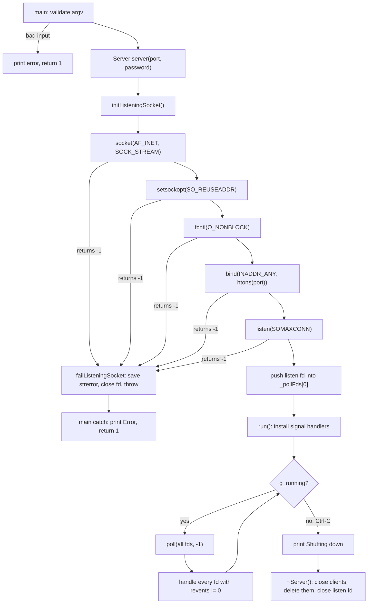
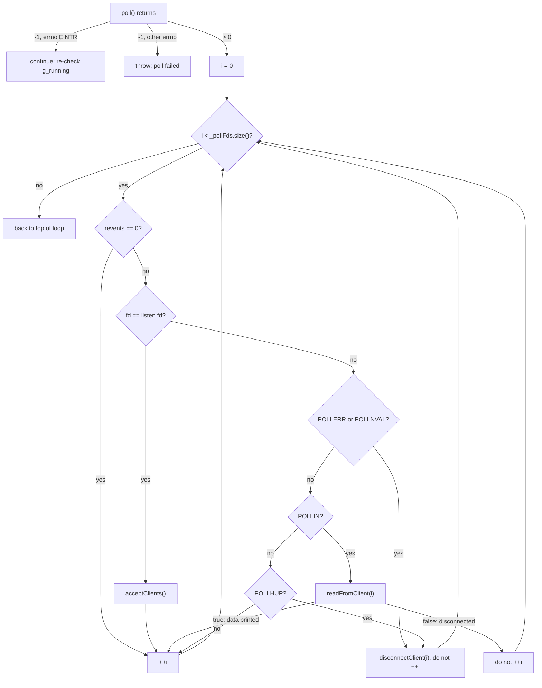
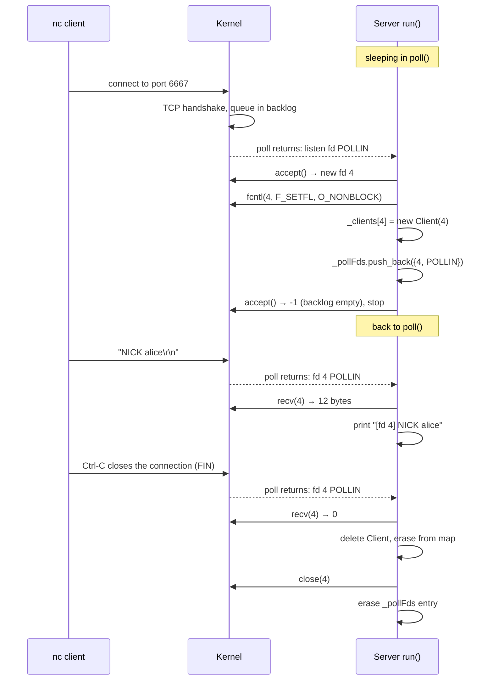
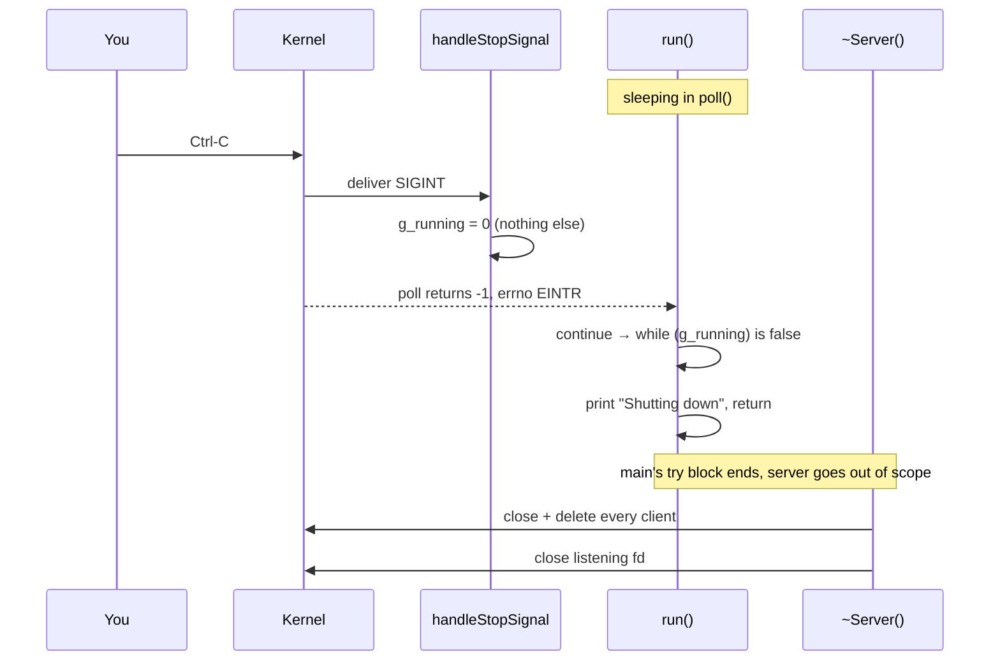

# Accept / Poll Workflow

How the server runs from start to Ctrl-C: the listening socket, the single
`poll()` loop, how clients arrive and leave, and how shutdown frees everything.
All the code described here is in `src/Server.cpp`.

> The diagrams are Mermaid. They render on GitHub, and in VS Code with the
> built-in Markdown preview (`Ctrl+Shift+V`) or a Mermaid preview extension.

**Interactive study page:** https://claude.ai/artifact/8avPGiciZQNtPE3sZx4Wxj
(same content with styled diagrams; private, so share it from the page's
Share menu before sending the link to anyone else)

---

## 1. The whole program: five phases

| Phase | What happens | Code |
|---|---|---|
| Validate | port and password from `argv` | `main()` |
| Construct | store values, `_listenFd = -1` | `Server()` |
| Listen | `socket` → `bind` → `listen` | `initListeningSocket()` |
| **Loop** | `poll`, then react to events | `run()` |
| Clean up | close every fd, delete clients | `~Server()` |



Every failure before the loop goes through one path: `failListeningSocket()`
reads `strerror(errno)` **before** `close()` (which may overwrite `errno`),
closes the fd, then throws. `main` catches it and prints `Error: ...`.

### The five socket calls

| Call | Why |
|---|---|
| `socket(AF_INET, SOCK_STREAM, 0)` | Create an IPv4 TCP endpoint. Returns an fd. |
| `setsockopt(SO_REUSEADDR)` | Restart on the same port right away instead of waiting ~60 s for TIME_WAIT. Must come **before** `bind`. |
| `fcntl(fd, F_SETFL, O_NONBLOCK)` | Non-blocking, as the subject requires. The only allowed `fcntl` form. |
| `bind(INADDR_ANY, htons(port))` | Claim the port on every interface. `htons` swaps the 2 bytes into network (big-endian) order; without it 6667 becomes 2842. |
| `listen(SOMAXCONN)` | Become a passive socket; the kernel queues incoming connections (the backlog) until `accept()`. |

---

## 2. The data the loop works on

Two containers, kept in sync. A client exists in **both or neither**.

**`std::vector<pollfd> _pollFds`**: what the kernel watches

| index | fd | events | revents (example, after poll) |
|---|---|---|---|
| 0 | 3 (listening) | `POLLIN` | `POLLIN`: new connection waiting |
| 1 | 4 | `POLLIN` | `0`: nothing happened |
| 2 | 5 | `POLLIN` | `POLLIN`: data arrived |
| 3 | 6 | `POLLIN` | `POLLIN`: `recv()` will return 0 |

**`std::map<int, Client *> _clients`**: what the server knows about each connection

| key (fd) | value |
|---|---|
| 4 | `Client(4)` |
| 5 | `Client(5)` |
| 6 | `Client(6)` |

- fds 0, 1, 2 are stdin, stdout, stderr, so the listening socket gets 3 and clients start at 4.
- You set `events`. The kernel fills `revents` every time `poll()` returns.
- `POLLHUP`, `POLLERR`, `POLLNVAL` are always reported even if you didn't ask for them.

---

## 3. One pass through the loop



| Flag in `revents` | On the listening fd | On a client fd |
|---|---|---|
| `POLLIN` | Connections are waiting. Call `accept()` until it returns -1. | Bytes arrived, or the client closed. Call `recv()` once. |
| `POLLHUP` | Not expected. | Connection gone. Checked **after** `POLLIN` so final data is still read. |
| `POLLERR` / `POLLNVAL` | Not expected. | Socket error or invalid fd. Disconnect at once. |
| `POLLOUT` | Not used yet. | Comes with the output-buffering issue: request it only while a client has data waiting to be sent. |

### `recv()` return values

| Return | Meaning | Action |
|---|---|---|
| `> 0` | That many bytes arrived (maybe half a line, maybe three lines) | Print for now; later: append to the client's input buffer |
| `0` | The client closed the connection | Disconnect |
| `-1` | Error (after `POLLIN`) | Disconnect. **Never** check `errno == EAGAIN` and retry |

---

## 4. A client's life: connect to disconnect



A closed connection shows up as **readable**: `POLLIN`, then `recv()` returns 0.
That is how the server tells "client left" apart from "client sent data".

---

## 5. The trap in the loop: why index, and no `++i` after erase

Say fd 5 (index 2) disconnects, and fd 6 behind it also has data waiting.
`erase()` shifts every later element one slot left.

```
before erase:   [0] fd 3   [1] fd 4   [2] fd 5   [3] fd 6
after erase:    [0] fd 3   [1] fd 4   [2] fd 6
```

- **Wrong (always `++i`):** fd 6 slides into slot 2, then `i` becomes 3.
  fd 6 is skipped in this pass and its data waits for the next `poll()`.
- **Right (stay on `i` after erase):** `i` stays 2, which now holds fd 6,
  so it is handled in the same pass.

The opposite case is `push_back()` in `acceptClients()`: it can **reallocate**
the vector, invalidating any `pollfd &` or iterator you were holding. An index
survives both, so the loop never keeps a reference across a call. New clients
are added at the end with `revents == 0`, so the current pass skips them.

---

## 6. Shutdown: how Ctrl-C becomes a clean exit



- Without the handler, SIGINT kills the process on the spot and **no destructor runs**.
- The handler only sets a `volatile sig_atomic_t` flag: a signal can interrupt the
  program anywhere (even mid-`new` or mid-`map` update), and that is the only thing
  guaranteed safe to do there.
- `sa_flags = 0` (no `SA_RESTART`) makes `poll()` return -1 with `EINTR` instead of
  quietly going back to sleep. Reading `errno` here is fine: it is `poll()`, not socket I/O.
- `SIGPIPE` is ignored, so a later `send()` to a dead client returns -1 instead of
  killing the server. (`MSG_NOSIGNAL` is Linux-only, so it isn't used.)

---

## 7. Rules the code follows (what evaluators check)

| Rule | How |
|---|---|
| One `poll()` for everything | The listening fd and every client fd are in the same set. No second wait anywhere. |
| I/O only after readiness | `accept()` and `recv()` are only called when `poll()` reported `POLLIN` for that fd. |
| Every fd non-blocking | Exactly `fcntl(fd, F_SETFL, O_NONBLOCK)` on the listening fd and each accepted fd. No other flags. |
| `errno` never drives I/O | The accept loop stops on a -1 return. `recv()` errors disconnect. `errno` is only read for messages and `poll()`'s `EINTR`. |
| Server owns every fd | Each fd is closed exactly once: in `disconnectClient()` or the destructor. `Server` and `Client` can't be copied. |
| No leaks on any exit | Errors, client disconnects and Ctrl-C all end with valgrind showing 3 std fds and no heap in use. |

---

## 8. Code map (`src/Server.cpp`)

| Function | Job |
|---|---|
| `installSignalHandlers()` | SIGINT/SIGTERM set `g_running = 0`; SIGPIPE ignored. |
| `initListeningSocket()` | The five socket calls, then puts the listening fd at `_pollFds[0]`. |
| `failListeningSocket()` | Saves `strerror(errno)`, closes the fd, throws. |
| `run()` | The loop: `poll`, then walk the set by index and dispatch on `revents`. |
| `acceptClients()` | `accept` until -1; for each: non-blocking, `new Client`, add `pollfd`. |
| `readFromClient()` | One `recv()`. 0 or -1 → disconnect, return false; otherwise print, return true. |
| `disconnectClient()` | Delete Client, erase from map, close fd, erase `pollfd`. |
| `~Server()` | Close and delete all remaining clients, then close the listening fd. |

Two `TODO`s mark the next issues: **input buffering** in `readFromClient()`, and
**removing a client from channels** in `disconnectClient()`.

---

## 9. Testing

```bash
make && ./ircserv 6667 pw
# in 2-3 other terminals:
nc -C localhost 6667
```

- Type in each client → server prints `[fd N] ...`
- Ctrl-C a client → `Client disconnected: fd N`, others keep working
- Ctrl-C the server with clients still connected → `Shutting down`, every `nc` exits

Leak check (use a regular terminal: VS Code's terminal leaks its own fds,
shown as `<inherited from parent>`):

```bash
valgrind --track-fds=yes --leak-check=full ./ircserv 6667 pw
```

Expected at the end: `FILE DESCRIPTORS: 3 open (3 std)` and
`All heap blocks were freed -- no leaks are possible`.

Useful commands:

| Command | Shows |
|---|---|
| `ss -ltnp \| grep 6667` | which process is listening on the port |
| `nc -C localhost 6667` | connect as a client (`-C` sends `\r\n` on Enter) |

---

## 10. Check yourself

<details>
<summary>Why does the listening socket never receive chat messages?</summary>

Its only job is to accept connections. Each `accept()` returns a new fd for that
client, and all of that client's data goes through its own fd.
</details>

<details>
<summary>A client closes its terminal. Which flag does poll() report, and what does recv() return?</summary>

`POLLIN` (sometimes with `POLLHUP`), and `recv()` returns 0. Zero bytes means the
peer closed the connection.
</details>

<details>
<summary>Why loop accept() until it returns -1, instead of calling it once?</summary>

Several clients can connect between two `poll()` calls, so one `POLLIN` on the
listening fd can mean many waiting connections. Because the fd is non-blocking,
`accept()` returns -1 when the queue is empty instead of freezing.
</details>

<details>
<summary>Why is POLLIN checked before POLLHUP?</summary>

A client can send its last data and close at the same moment. Reading first means
that data is processed; the following `recv()` then returns 0 and disconnects normally.
</details>

<details>
<summary>What would happen with ++i after disconnectClient(i)?</summary>

The element after the erased one shifts into slot `i` and gets skipped for this
pass. Its event waits until the next `poll()`.
</details>

<details>
<summary>Why can the signal handler only set a flag?</summary>

It can interrupt the program at any instruction, even halfway through a `std::map`
update or a `new`. Only writing a `volatile sig_atomic_t` is guaranteed safe there.
The real cleanup happens later, in normal code.
</details>

<details>
<summary>Why does the input-buffering issue exist?</summary>

TCP is a byte stream, not a message stream. In testing, one client's
`PRIVMSG #a :split` arrived as `PRIV` in one `recv()` and `MSG #a :split` in the
next. A per-client buffer must join the pieces and cut on `\r\n`.
</details>
